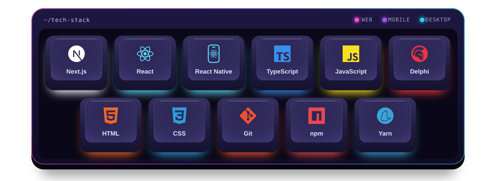
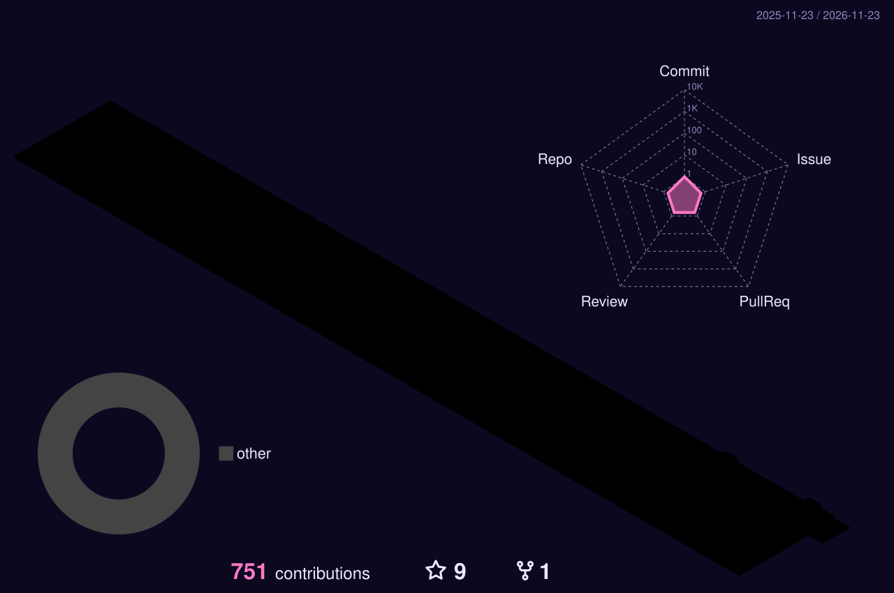

  

  
  &nbsp;
  

<h3 align="center">⌨️ Tech Stack</h3>

  

<h3 align="center">🧊 Contributions in 3D</h3>

  

  <picture>
    <source media="(prefers-color-scheme: dark)" srcset="./profile-snake/snake-dark.svg" />
    <source media="(prefers-color-scheme: light)" srcset="./profile-snake/snake-light.svg" />
    
  </picture>

  

